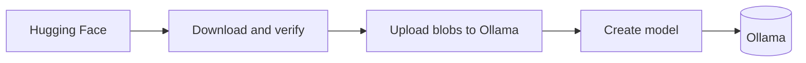

# hf2ollama

Browse Hugging Face and import GGUF and supported safetensors models into Ollama, from a single portable desktop app.


> **Status: pre-release, under active development.** The core library (Hugging Face and Ollama clients, import pipeline, job manager, fit estimation) is implemented and tested. The desktop GUI is still being built, so there is no usable application and no release yet. Everything under "Planned v0.1 features" is a plan, not a shipped feature. Expect breaking changes.

## Why

Getting a model from Hugging Face into Ollama usually means downloading files by hand, working out which quantization fits your machine, and writing a Modelfile. hf2ollama is meant to turn that into search, pick, import. It talks to Ollama only through its HTTP API, so it works with any Ollama you can reach, including one whose models directory is not `~/.ollama/models` and one running on another machine.

## Planned v0.1 features

- Browse and search Hugging Face, with filters and per-model metadata (size, quantization, architecture, context length, license).
- Compatibility detection with explanations: GGUF repos, safetensors repos with a supported architecture, and unsupported repos, which are detected before any download and explained.
- A quantization picker with fit estimates for your machine (RAM, and VRAM where it can be detected reliably), with a manual hardware override.
- Import through the Ollama API: download with resume, verify checksums, upload blobs, create the model.
- Pause, resume and cancel for each job, with a timestamped log per job.
- An Installed view backed by the Ollama API, with delete (two-click confirmation).
- Settings: Ollama address, staging folder, cleanup behavior, parallel downloads, Hugging Face token (kept in the system keychain) and endpoint, theme.
- Light and dark themes.
- Portable mode.

See [docs/ROADMAP.md](docs/ROADMAP.md) for what is done, what is next and what is deliberately out of scope.

## How it works



hf2ollama downloads the chosen files into a temporary staging folder, checks them against the checksums Hugging Face publishes, uploads each file to Ollama as a blob (`/api/blobs`), then asks Ollama to create the model from those blobs (`/api/create`). Staging files are removed afterwards unless you choose to keep them. Details are in [docs/ARCHITECTURE.md](docs/ARCHITECTURE.md).

## Requirements

- Ollama, reachable over HTTP. The API behavior was verified against Ollama 0.40.8, and that is the tested version. Older versions were not tested.
- Rust (stable) to build from source.
- Target platforms are macOS, Windows and Linux. Honest status: the Ollama and Hugging Face behavior was verified on macOS only, and the UI prototype was checked on macOS only. CI builds and tests on all three. Safetensors import in particular is unverified on Linux and Windows (see [docs/FAQ.md](docs/FAQ.md)).

## Build and run from source

```sh
cargo build --release
cargo run -p hf2ollama-gui --release
```

The GUI crate is under construction, so running it may not give you a working application yet. On Linux you need the development packages used in CI: `libxkbcommon-dev`, `libwayland-dev` and `libgtk-3-dev`. To run the tests (no network needed):

```sh
cargo test
```

More in [docs/DEVELOPMENT.md](docs/DEVELOPMENT.md).

## Portable mode

Create an empty file named `portable` next to the executable. Settings, import history and logs are then stored beside the executable, and the default staging folder is there too. Without that file, the OS config, cache and log directories are used.

## Documentation

- [Architecture](docs/ARCHITECTURE.md)
- [FAQ](docs/FAQ.md)
- [Development](docs/DEVELOPMENT.md)
- [Roadmap](docs/ROADMAP.md)
- [Changelog](CHANGELOG.md)

## Contributing

Contributions are welcome. Please read [CONTRIBUTING.md](CONTRIBUTING.md) and the [Code of Conduct](CODE_OF_CONDUCT.md) first.

## Security

Please report vulnerabilities privately. See [SECURITY.md](SECURITY.md).

## License

Licensed under either of

- Apache License, Version 2.0 ([LICENSE-APACHE](LICENSE-APACHE))
- MIT license ([LICENSE-MIT](LICENSE-MIT))

at your option. Bundled fonts and other third-party material are covered in [THIRD_PARTY_LICENSES.md](THIRD_PARTY_LICENSES.md).

Unless you explicitly state otherwise, any contribution intentionally submitted for inclusion in this project, as defined in the Apache-2.0 license, shall be dual licensed as above, without any additional terms or conditions.
