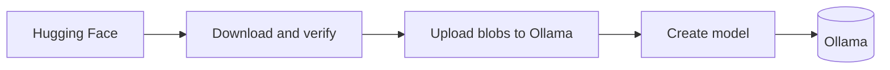

# Roost

Browse Hugging Face and import GGUF and supported safetensors models into Ollama, from a single portable desktop app.


> **Status: pre-release.** The core library and the desktop app are implemented: Browse (search, filters, details, model card, import plan), the downloads dock, Installed and Settings, in four theme families (Meadow, Ember, Plum, Tide) with light and dark variants. They are covered by automated tests (core and GUI unit and layout tests, plus opt-in end-to-end tests against a real Ollama). There is no published release yet (as of 2026-10-27 there are no tags, GitHub releases or release-workflow runs), though macOS is packaged as a universal app and DMG. What has and has not been verified:
>
> - Verified: the import pipeline end to end against a throwaway local Ollama 0.40.8 on macOS (GGUF, safetensors with `int8` and with no quantization, delete, cancel, pause and resume, name collision), using the public Hugging Face API. Details in [docs/superpowers/notes/acceptance.md](docs/superpowers/notes/acceptance.md).
> - Not verified: Linux and Windows were not built or run here (CI is configured for them but has not run); a remote Ollama was not tried; screenshots and the final side-by-side visual check against the mockup are still outstanding because the build machine's display was locked.
>
> Expect breaking changes.

<!-- TODO: add screenshots (light and dark: Browse, downloads dock, Installed, Settings) once captured on an unlocked display. -->

## Why

Getting a model from Hugging Face into Ollama usually means downloading files by hand, working out which quantization fits your machine, and writing a Modelfile. Roost is meant to turn that into search, pick, import. It talks to Ollama only through its HTTP API, so it works with any Ollama you can reach, including one whose models directory is not `~/.ollama/models` and one running on another machine.

## Features (v0.1)

All of these are implemented; see the status banner for what was verified.

- Browse and search Hugging Face, with filters and per-model metadata (size, quantization, architecture, context length, license).
- Compatibility detection with explanations: GGUF repos, safetensors repos with a supported architecture, and unsupported repos, which are detected before any download and explained.
- A quantization picker with fit estimates for your machine (RAM, and VRAM where it can be detected reliably), with a manual hardware override.
- Import through the Ollama API: download with HTTP Range resume (retrying up to 3 times after a network error, 5xx or 429), verify checksums, upload blobs, create the model. Resuming a failed job or resuming after a restart is not supported yet.
- Pause, resume and cancel for each job, with a rolling download speed and a timestamped log in a five-line, scrollable drawer above the dock. Closing the window with running downloads asks first.
- A model name that already exists in Ollama is refused (checked at the start and again just before the model is created); overwriting is not offered.
- A model card (About this model) for each repository, rendered as a safe subset of Markdown: no raw HTML, no images, only plain web links.
- An Installed view backed by the Ollama API, with delete (two-click confirmation with a short pause before the second click counts).
- Settings: Ollama address, staging folder, cleanup behavior, parallel downloads, Hugging Face token (kept in the system keychain) and endpoint, theme.
- Four theme families (Meadow, Ember, Plum, Tide), each light and dark, with an app icon.
- Coming from hf2ollama: settings and import history are copied to Roost on first start (the originals are left alone), and the Hugging Face token can be imported from Settings on request.
- Portable mode.
- macOS releases are a universal `.app` inside a drag-install `.dmg` (unsigned and not notarized for now).

The window has a minimum size of 900 by 640; the layout is designed and tested down to that size.

Roost is growing into a local-model workbench. **Chat is available**: stream a reply from any installed model, keep conversations in a history rail (pin, rename, delete), and start an **incognito** chat that lives only in memory and is gone when you close it or quit. Replies keep running in the background while you browse or import. Each conversation is saved as its own file under the history folder (`sessions/` next to the app in portable mode); only one Roost can use a history at a time.

Read-only agents, `/btw` side threads, branches, automatic titles and a history search/manager are **planned, not available**. The stages are in [docs/ROADMAP.md](docs/ROADMAP.md).

See [docs/ROADMAP.md](docs/ROADMAP.md) for what is done, what is next and what is deliberately out of scope.

## How it works



Roost downloads the chosen files into a temporary staging folder, checks them against the checksums Hugging Face publishes, uploads each file to Ollama as a blob (`/api/blobs`), then asks Ollama to create the model from those blobs (`/api/create`). Staging files are removed afterwards unless you choose to keep them. Details are in [docs/ARCHITECTURE.md](docs/ARCHITECTURE.md).

## Requirements

- Ollama, reachable over HTTP. The API behavior was verified against Ollama 0.40.8, and that is the tested version. Older versions were not tested.
- Rust (stable) to build from source.
- Target platforms are macOS, Windows and Linux. Honest status: the Ollama and Hugging Face behavior was verified on macOS only, and the UI prototype was checked on macOS only. CI builds and tests on all three. Safetensors import in particular is unverified on Linux and Windows (see [docs/FAQ.md](docs/FAQ.md)).

## Build and run from source

Build needs Rust 1.95 or newer (the highest minimum declared by a dependency; `cargo +1.95 check` passes).

```sh
cargo build --release -p roost-gui
cargo run -p roost-gui --release
```

On Linux you need the development packages used in CI: `libxkbcommon-dev`, `libwayland-dev`, `libx11-dev` and `libgl1-mesa-dev`. The file dialog uses the XDG desktop portal over D-Bus, so no GTK packages are needed, but a portal must be running for the folder picker to work. This list has not been tried on a real Linux machine yet. To run the tests (no network needed):

```sh
cargo test --workspace
```

The `dev-hooks` cargo feature adds screenshot and trial hooks (such as an in-memory token store). It is off by default and absent from release builds; see [docs/DEVELOPMENT.md](docs/DEVELOPMENT.md). Opt-in end-to-end tests against a real Ollama are described there too.

More in [docs/DEVELOPMENT.md](docs/DEVELOPMENT.md).

## Portable mode

Create an empty file named `portable` next to the executable. Settings, import history and logs are then stored beside the executable, and the default staging folder is there too. Without that file, the OS config, cache and log directories are used.

## Documentation

- [Architecture](docs/ARCHITECTURE.md)
- [FAQ](docs/FAQ.md)
- [Development](docs/DEVELOPMENT.md)
- [Roadmap](docs/ROADMAP.md)
- [Changelog](CHANGELOG.md)

## Contributing

Contributions are welcome. Please read [CONTRIBUTING.md](CONTRIBUTING.md) and the [Code of Conduct](CODE_OF_CONDUCT.md) first.

## Security

Please report vulnerabilities privately. See [SECURITY.md](SECURITY.md).

## License

Licensed under either of

- Apache License, Version 2.0 ([LICENSE-APACHE](LICENSE-APACHE))
- MIT license ([LICENSE-MIT](LICENSE-MIT))

at your option. Bundled fonts and other third-party material are covered in [THIRD_PARTY_LICENSES.md](THIRD_PARTY_LICENSES.md).

Unless you explicitly state otherwise, any contribution intentionally submitted for inclusion in this project, as defined in the Apache-2.0 license, shall be dual licensed as above, without any additional terms or conditions.
