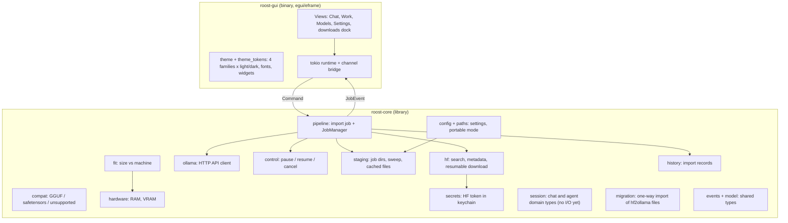
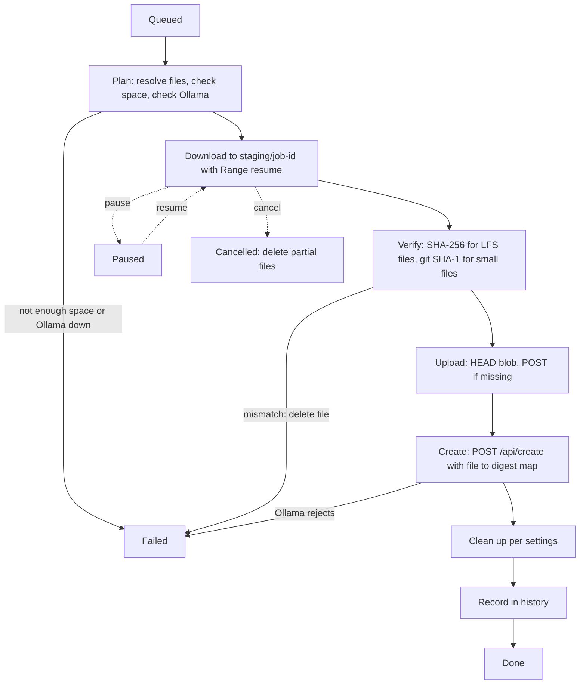
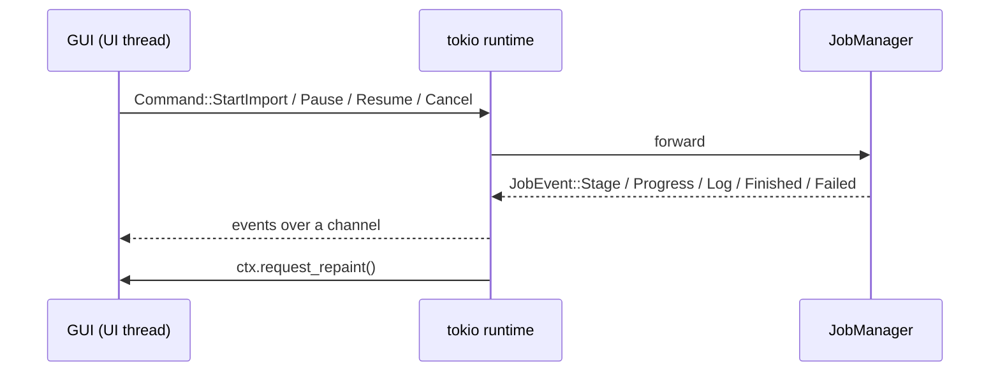

# Architecture

This is a contributor overview. The approved design is in `docs/superpowers/specs/2026-10-22-hf2ollama-design.md` (sections 3 and 4 are summarized here); the Roost workbench direction is in `docs/superpowers/specs/2026-10-27-roost-workbench-design.md`, and verified API behavior is in `docs/superpowers/notes/api-verification.md`. If this page and the spec disagree, the spec and the code win; please fix this page.

Status: the importer (Browse, Installed, Settings, downloads) is implemented and tested. Chat and agents are planned (see `docs/ROADMAP.md`); only their data types exist so far.

## Crate layout

The workspace has two crates. The core is a library with no UI dependencies; the GUI is a thin binary on top of it.

Hard rules that follow from this layout:

- Core never imports egui.
- The GUI never makes HTTP calls. It sends commands to core and reads events.
- The public core API is async and returns typed errors (`thiserror`). No `unwrap` or `expect` on I/O, network or parse results in non-test code.
- TLS is rustls only. OpenSSL must not enter the dependency tree (enforced by `deny.toml`).

## Modules in `roost-core`

| Module | Responsibility |
|---|---|
| `hf` (`search`, `download`) | Search models; fetch metadata and the file list with sizes and SHA-256 (`?blobs=true`); download files with HTTP Range resume while hashing. Redacts the token in `Debug`. |
| `ollama` | Client for `/api/version`, `/api/tags`, `/api/show`, `/api/blobs/:digest` (HEAD and POST), `/api/create` (streamed) and `/api/delete`. |
| `pipeline` | Runs one import job end to end and emits events. Also holds `JobManager`, which queues jobs and enforces the parallel-download limit. |
| `control` | `JobControl`: the pause, resume and cancel flags a job checks at checkpoints and races against network waits. |
| `staging` | Per-job folders under the staging root, free-space checks, cleanup guarantees, startup sweep of orphans and expired partials, listing and clearing of cached files. |
| `compat` | Classifies a repo as GGUF (with options, shards grouped), safetensors with a supported architecture, or unsupported with a reason. The architecture list is bundled data (`supported_architectures.json`). |
| `fit` | Pure function from model size and a machine profile to a verdict: fits, tight, partial offload, too large. |
| `hardware` | Detects RAM (`sysinfo`) and VRAM where reliable (NVIDIA through NVML, Apple unified memory). Accepts a manual override. |
| `config`, `paths` | Settings (TOML; enum values are kebab-case such as `five-minutes`, and the older PascalCase spellings still load) and storage locations. If a file named `portable` is next to the executable, everything lives beside it. |
| `secrets` | Hugging Face token in the system keychain, with an in-memory store for tests. |
| `history` | JSON record of which Hugging Face repo produced which Ollama model name. |
| `names` | Validation of Ollama model names. |
| `events`, `model` | `Command`, `JobEvent`, `Stage`, `JobId` and request types shared with the GUI. |
| `error` | The crate's error type. |

## Import pipeline

One job per import. Stages: `Queued`, `Downloading`, `Verifying`, `Uploading`, `Creating`, `CleaningUp`, `Done`, plus `Paused`, `Failed(reason)` and `Cancelled`.

1. **Plan.** Resolve the selected file or files, compute download and final size, check free space in the staging folder, check Ollama is reachable. Refuse with a clear message if space is insufficient.
2. **Download** into `<staging>/<job-id>/`, resuming with HTTP Range. A `206` response whose `Content-Range` does not match the resume offset restarts the download. The token is used for gated repos. A file that fails with a network error (including a stall), a 5xx or a 429 is retried up to 3 times on the same job folder with waits of 1, 2 and 4 seconds (a retry-after hint is honoured, capped at 30 seconds); the wait races against cancel and respects pause, and each retry is logged. Checksum mismatches, gated repos, other 4xx errors, unsafe paths and cancels are never retried. A body longer than the declared size is cut off at once.
3. **Verify.** Hugging Face publishes SHA-256 only for LFS files. Those are checked against it. Small non-LFS files (config, tokenizer JSON) are checked against the git blob SHA-1. The app also computes SHA-256 for every file locally, since Ollama's blob upload needs it. A mismatch fails the job and deletes the bad file.
4. **Upload** each file as a blob: `HEAD /api/blobs/sha256:<hex>` and skip if present, otherwise `POST`.
5. **Create** with `POST /api/create` (after checking again that the model name is still free, unless overwrite was requested), mapping file names to blob digests. For safetensors the request includes weights, config and tokenizer files and the user's `quantize` choice (or none).
6. **Clean up** according to settings, then record the import in history.

Each job has a timestamped log (queued, request results, stage completions, pause, resume, cancel, errors). It is also written to a log file for bug reports.

## Command and event channels

The GUI owns a tokio runtime. The UI thread sends `Command`s and drains `JobEvent`s; it never blocks on I/O. The receiving side calls `ctx.request_repaint()` so progress draws immediately. Event and command types live in core (`events`) so both sides share them.

## The GUI layer

`roost-gui` is a binary with these parts:

- **Startup** (`startup.rs`, `main.rs`). `startup()` resolves paths (portable or OS directories), loads settings and ignores an unusable saved staging folder (not absolute, contains `..`, or starts with `~`), without opening a window or writing files. `spawn_sweep` runs `Staging::sweep` once on its own thread before any job exists and appends the report to `startup.log` in the log directory.
- **Backend bridge** (`runtime.rs`). The backend thread owns the tokio runtime, the Hugging Face and Ollama clients, the history and the job managers. The UI sends `BackendRequest` values (core commands, search, model info, model card, installed list and delete, settings apply, token set and check, cached files) over an mpsc channel and drains `UiEvent` values (job events, search and info results, installed lists, status polls, settings saved, token status, cached files). Every event wakes the UI with `ctx.request_repaint()`. The GUI makes no HTTP calls itself.
- **App state** (`app.rs`). `AppState` is plain data that folds `UiEvent`s in `on_event` and may answer with a follow-up request (for example a fresh installed list after a job finishes). Views read it and push requests; tests drive it without a window.
- **Browse** (`browse/`). Filters, result list, lazy details, option tables, the import plan card, and the model card tab (`markdown.rs` and `about.rs`).
- **Downloads dock** (`dock/`). `JobsState` in `dock/jobs.rs` is a pure reducer: it turns `JobEvent`s into rows (status, progress, step, log capped at 2000 lines, auto-dismiss deadline). `dock/mod.rs` only draws rows and reports button clicks as actions.
- **Models** (`models/`). One list (filter chips, usage bar, an Installed section, a Hugging Face section) and one detail pane that shows either an installed model (Chat, Work, Delete, then details) or a repository (the Browse detail). `installed/state.rs` is the pure model behind the Installed section.
- **Settings** (`settings/`, `confirm.rs`). Pure state plus drawing; destructive buttons share the two-step confirm in `confirm.rs` (4 s window, 600 ms minimum delay, held keys never confirm). Settings validators live in `settings/validate.rs`.
- **Closing the window** (`quit.rs`). `QuitState` (`Idle`, `Confirming`, `Cancelling`, `Closing`) is a pure state machine. A close request with unsettled jobs is cancelled and a confirmation is shown ("Keep running", the default, or "Quit and cancel"); the latter sends `Cancel` for every unsettled job and closes once they settle or after 3 seconds. Held Enter or Space never confirms.
- **Import names** (`app.rs`, `dock/jobs.rs`). The Download button is disabled while an unsettled job, or a click not yet answered by `JobAccepted`, uses the same normalized name.
- **Layout tests.** Each view has tests that run real egui frames at 900 by 640 and 1180 by 820 and check rectangles (nothing clipped, buttons fully visible).

### Model card safety

The README is fetched by core (capped at 256 KiB, front matter stripped) and parsed into a small block tree in `browse/markdown.rs`. Raw HTML never survives, images are never loaded, and only absolute `http` and `https` links are kept (opened in the browser, never fetched). Budgets bound the work per frame: nesting depth 8, 400 blocks, 1000 spans per block, tables of at most 20 columns and 200 rows, 500 list items and 2000 drawn items per document. Anything past a budget is cut and the card says it is truncated.

### Quantization values

For safetensors the picker offers none, `int8` and `int4`, and the request carries the choice in `quantize` (omitted for none). On Ollama 0.40.8 the server accepts `int4`, `int8`, `nvfp4`, `mxfp4` and `mxfp8` and rejects the older `q8_0` style names. `int8` and no quantization were imported end to end (see the acceptance record); `int4` is accepted by the server according to its error message but was not imported here. The vocabulary is version dependent, so these values are an assumption for other Ollama versions. GGUF files are uploaded as they are and never re-quantized.

## Cleanup guarantees

- Every job gets its own directory under the staging root. The directory handle is consumed by `finish(keep)` or `discard()`, and the pipeline routes every outcome through them.
- Cancel always deletes the partial files.
- A failed job keeps its files for 7 days if that setting is on (they are not reused by a new import; resuming after a restart is not supported yet); otherwise it deletes them. "Clear cached files" removes kept and failed job directories, never a directory without a marker (an active job). On startup the GUI runs `Staging::sweep` once, off the UI thread, which removes only marker-guarded orphaned job directories and expired partials; foreign files in the staging folder are never touched.
- With "delete downloaded files after import" on, no job leaves files after success, cancel or failure (other than failed-job files kept for 7 days when enabled). With it off, kept files are listed as cached files and can be cleared.
- A create that has already completed wins over a late cancel, and an in-flight create is not abandoned.

## Roost foundation

- **Names and paths.** The crates are `roost-core` and `roost-gui`, the binary is `roost`, settings are `roost.toml` and the keychain service is `roost`. Portable mode still uses the marker file `portable`.
- **Migration** (`migration`, `secrets`, `staging`). On startup, settings and import history are copied from the hf2ollama locations only where the Roost file does not exist; legacy files are never changed or removed, and a failed copy leaves both sides as they were. Staging cleanup recognizes both the `.roost-job` and the old `.hf2ollama-job` markers. The Hugging Face token is not read at startup: Settings offers an explicit "import" action, because macOS may show a Keychain prompt. A token already stored for Roost always wins and the old entry is kept.
- **Atomic writes** (`persistence`). Settings and history are written through one helper that uses a unique temp name, syncs, then renames, so concurrent writers never collide and a failure leaves the old file intact.
- **Themes.** `theme_tokens` holds the colour table for Meadow, Ember, Plum and Tide in light and dark; tests require 4.5:1 contrast for the main text and button pairs and run layout checks for all eight at the minimum window size.
- **Sessions** (`session`). Serializable types for chats and agents: IDs, messages (user, assistant, tool), run state, tool configuration snapshot, titles, branch origin and a versioned `SessionDocument`. They contain validation and small helpers for building a transcript.

## Chat and history (stage 2)

- **Manager** (`chat::manager`). One task owns every open session, the incognito map and the rule of at most one reply per session. The GUI sends `ChatCommand` intents and receives ordered `ChatEvent`s tagged with session and turn IDs; each turn ends with exactly one terminal event (completed, failed or cancelled), and anything after it is dropped. Text deltas are batched for about 30 ms and always sent before the terminal event. Opening a running session sends the pending text first so a viewer never appends it twice.
- **Runs** (`chat::run`). One task per reply talks to Ollama and only reports what the stream did; the manager decides what it means. Stop, delete and quit signal the task and the manager records the outcome itself.
- **Streaming client** (`ollama::chat`). `POST /api/chat` as newline-delimited JSON, buffering bytes so a split multi-byte character decodes. A 404 becomes "model not found"; an error line mid-stream, a malformed line, a stall (120 s between events, 5 min for the first) and a stream that ends without `done` all fail the turn once.
- **Context** (`chat::context`). The window sent as `num_ctx` is the session override, else the model's reported length capped at 16,384, else 8,192. Requests keep the system prompt and newest message, drop whole old exchanges that do not fit 70% of the window (and exchanges whose reply failed), and add an "Earlier messages omitted" marker. The stored transcript is never trimmed.
- **Store** (`store`). `sessions/<id>.json` per session plus `index-v1.json`, which is derived data: it is reconciled with the files on every start (file time and size), so a crash between the two writes loses nothing. A damaged file is renamed `.corrupt-<time>` and kept, a newer-schema file is left untouched, a read error changes nothing. A `.lock` file allows one Roost per history. All disk work runs on one writer thread; deleting a session tombstones its id so a late save cannot bring the file back.
- **GUI** (`roost-gui::chat`). `state` folds events into plain data (rail grouping, drafts, run badges); `view` renders. Incognito never reaches the store or the logs, and a test fails if eframe persistence is ever enabled.

## Agents (stage 3)

- **Jail** (`agent::workspace`). Every tool path is resolved through a `cap-std` directory handle rooted at the agent's folder, so absolute paths, `..`, NUL and escaping symlinks fail with no check-then-open race. A case-insensitive denylist keeps secrets unreadable. Walkers (`find_files`, `search_text`) never follow symlinks and skip `.git` and protected paths.
- **Tools and registry** (`agent::tools`, `agent::registry`). Four read tools with fixed limits and explicit truncation markers. Family, capability, permission and tool layers; read capabilities may be Auto, Ask or Off; the check runs again at call time. A tool set to Ask is offered to the model, and its call waits in the run (the tool slot holds the pending call, no task) until the window answers with `ResolveApproval` (Allow, Allow for this session, which sets the capability to Auto, or Deny, which is reported to the model as a failed call). Stop ends the wait; reopening the chat asks the question again.
- **Loop** (`chat::agent_loop`, inside the manager). A run is steps: stream one reply, run its tool calls one at a time on the blocking pool, repeat until the model answers without tools, Stop, a failure or the budget. Each reply is its own turn; `RunEnded` closes the run. Steering waits in an inbox and is applied at the next safe point; a streaming reply is interrupted and kept. Settings cannot change under a running agent.
- **Context** (`chat::context::build_agent_request`). Tool calls and their results are one group; the request always starts with a user message and keeps the newest user message; interrupted replies stay as the text they had.

## Window layout

`app.rs` draws the top bar (Chat, Work, Models, search on Models, the Ollama pill with its in-memory popover, the settings gear). `chat::view` lays out the rail and panes for the Chat and Work tabs; `chat::chrome` holds the small controls around a conversation (title row, overflow and folder menus, status line, model chip, folded tool steps). Controls that act rarely live in popovers that stay open while used (`CloseOnClickOutside`).

## Menu bar

`roost-gui::menu` describes the menus as data (`model`), handles a click in one place (`actions`) and renders the description three ways: native on macOS and Windows (`native`, `muda`), and in the window on Linux (`bar`, also used by tests). Notes that cost time to learn: the macOS menu must be attached on the first frame, not in the window creator, because macOS calls back into the event loop and aborts from inside winit's launch callback; `muda` honors only one event handler per process, so events are read from its channel by a small forwarding thread; macOS dispatches shortcuts in the menu while Windows and Linux dispatch them through egui, so a shortcut never fires twice; the Edit items use egui's clipboard commands and a synthesized ⌘A so text fields keep working.

## What is intentionally not done

- No writing into Ollama's model store. Everything goes through the HTTP API, so any models directory or a remote Ollama works.
- No deleting of blobs. Ollama has no blob-delete API, so a failed import after upload can leave an unused blob that Ollama prunes later.
- No format conversion. There is no Python or llama.cpp step, so architectures Ollama does not support are reported as unsupported.
- No running or chatting with models yet (planned, see the roadmap), no Modelfile editing beyond the model name, no uploading to Hugging Face, and no management of Ollama library pulls.
- No resume of failed jobs and no cross-restart resume of in-progress downloads in v1 (files of a failed job are kept for 7 days, but nothing reuses them and a restart does not pick the job back up).
