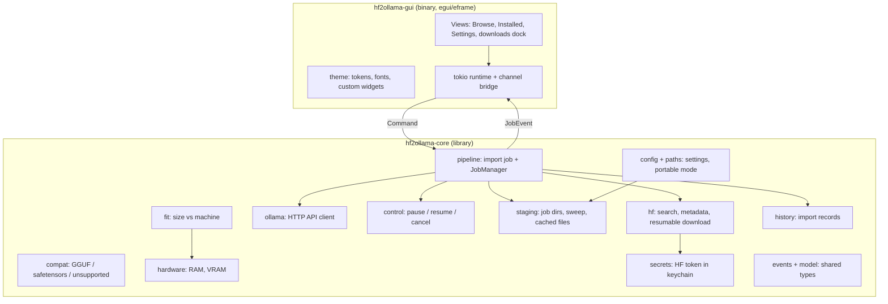
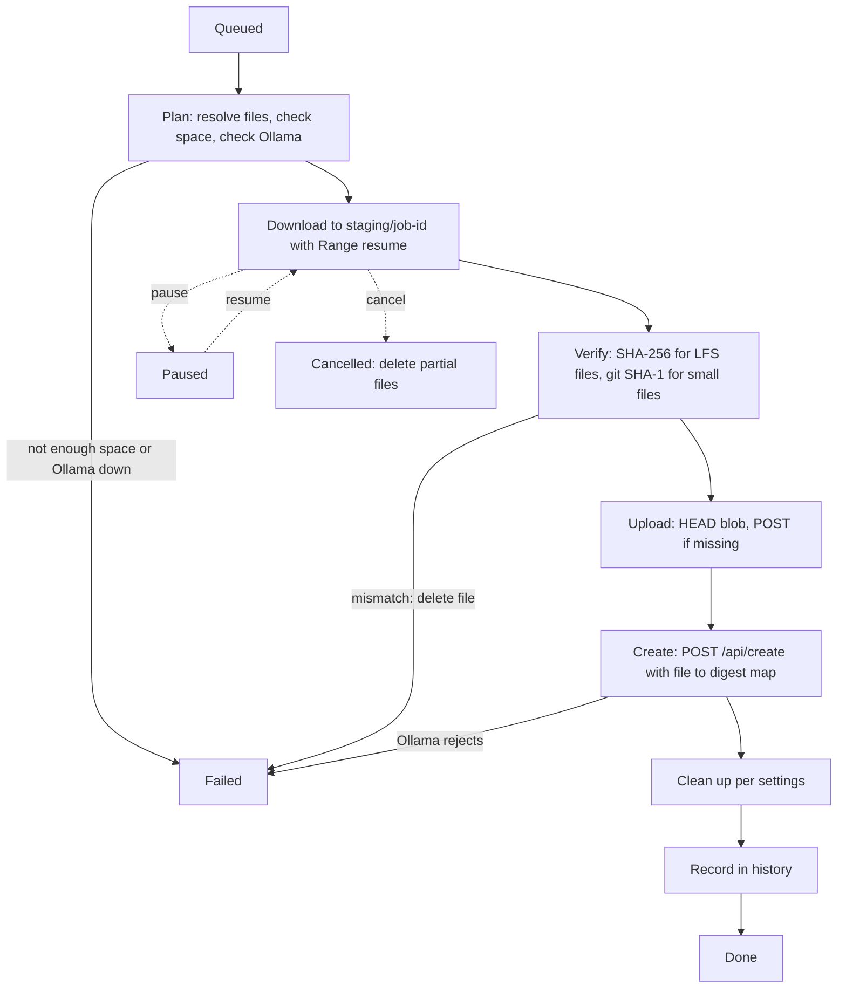
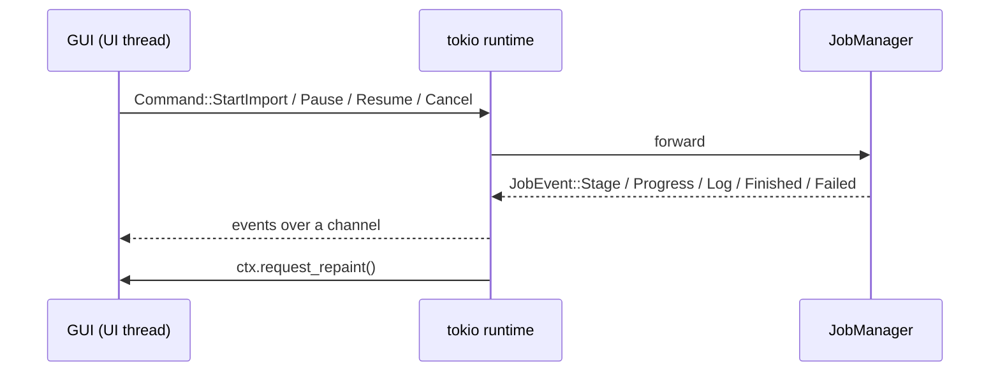

# Architecture

This is a contributor overview. The approved design is in `docs/superpowers/specs/2026-10-22-hf2ollama-design.md` (sections 3 and 4 are summarized here), and verified API behavior is in `docs/superpowers/notes/api-verification.md`. If this page and the spec disagree, the spec and the code win; please fix this page.

Status: the core crate is implemented and tested. The GUI crate is under construction, so the GUI parts below describe the design.

## Crate layout

The workspace has two crates. The core is a library with no UI dependencies; the GUI is a thin binary on top of it.

Hard rules that follow from this layout:

- Core never imports egui.
- The GUI never makes HTTP calls. It sends commands to core and reads events.
- The public core API is async and returns typed errors (`thiserror`). No `unwrap` or `expect` on I/O, network or parse results in non-test code.
- TLS is rustls only. OpenSSL must not enter the dependency tree (enforced by `deny.toml`).

## Modules in `hf2ollama-core`

| Module | Responsibility |
|---|---|
| `hf` (`search`, `download`) | Search models; fetch metadata and the file list with sizes and SHA-256 (`?blobs=true`); download files with HTTP Range resume while hashing. Redacts the token in `Debug`. |
| `ollama` | Client for `/api/version`, `/api/tags`, `/api/show`, `/api/blobs/:digest` (HEAD and POST), `/api/create` (streamed) and `/api/delete`. |
| `pipeline` | Runs one import job end to end and emits events. Also holds `JobManager`, which queues jobs and enforces the parallel-download limit. |
| `control` | `JobControl`: the pause, resume and cancel flags a job checks at checkpoints and races against network waits. |
| `staging` | Per-job folders under the staging root, free-space checks, cleanup guarantees, startup sweep of orphans and expired partials, listing and clearing of cached files. |
| `compat` | Classifies a repo as GGUF (with options, shards grouped), safetensors with a supported architecture, or unsupported with a reason. The architecture list is bundled data (`supported_architectures.json`). |
| `fit` | Pure function from model size and a machine profile to a verdict: fits, tight, partial offload, too large. |
| `hardware` | Detects RAM (`sysinfo`) and VRAM where reliable (NVIDIA through NVML, Apple unified memory). Accepts a manual override. |
| `config`, `paths` | Settings (TOML) and storage locations. If a file named `portable` is next to the executable, everything lives beside it. |
| `secrets` | Hugging Face token in the system keychain, with an in-memory store for tests. |
| `history` | JSON record of which Hugging Face repo produced which Ollama model name. |
| `names` | Validation of Ollama model names. |
| `events`, `model` | `Command`, `JobEvent`, `Stage`, `JobId` and request types shared with the GUI. |
| `error` | The crate's error type. |

## Import pipeline

One job per import. Stages: `Queued`, `Downloading`, `Verifying`, `Uploading`, `Creating`, `CleaningUp`, `Done`, plus `Paused`, `Failed(reason)` and `Cancelled`.

1. **Plan.** Resolve the selected file or files, compute download and final size, check free space in the staging folder, check Ollama is reachable. Refuse with a clear message if space is insufficient.
2. **Download** into `<staging>/<job-id>/`, resuming with HTTP Range. A `206` response whose `Content-Range` does not match the resume offset restarts the download. The token is used for gated repos.
3. **Verify.** Hugging Face publishes SHA-256 only for LFS files. Those are checked against it. Small non-LFS files (config, tokenizer JSON) are checked against the git blob SHA-1. The app also computes SHA-256 for every file locally, since Ollama's blob upload needs it. A mismatch fails the job and deletes the bad file.
4. **Upload** each file as a blob: `HEAD /api/blobs/sha256:<hex>` and skip if present, otherwise `POST`.
5. **Create** with `POST /api/create`, mapping file names to blob digests. For safetensors the request includes weights, config and tokenizer files and the user's `quantize` choice (or none).
6. **Clean up** according to settings, then record the import in history.

Each job has a timestamped log (queued, request results, stage completions, pause, resume, cancel, errors). It is also written to a log file for bug reports.

## Command and event channels

The GUI owns a tokio runtime. The UI thread sends `Command`s and drains `JobEvent`s; it never blocks on I/O. The receiving side calls `ctx.request_repaint()` so progress draws immediately. Event and command types live in core (`events`) so both sides share them.

## Cleanup guarantees

- Every job gets its own directory under the staging root. The directory handle is consumed by `finish(keep)` or `discard()`, and the pipeline routes every outcome through them.
- Cancel always deletes the partial files.
- A failed job keeps resumable partials for 7 days if that setting is on; otherwise it deletes them. On startup `Staging::sweep` removes orphaned job directories and expired partials.
- With "delete downloaded files after import" on, no job leaves files after success, cancel or failure (other than resumable partials when enabled). With it off, kept files are listed as cached files and can be cleared.
- A create that has already completed wins over a late cancel, and an in-flight create is not abandoned.

## What is intentionally not done

- No writing into Ollama's model store. Everything goes through the HTTP API, so any models directory or a remote Ollama works.
- No deleting of blobs. Ollama has no blob-delete API, so a failed import after upload can leave an unused blob that Ollama prunes later.
- No format conversion. There is no Python or llama.cpp step, so architectures Ollama does not support are reported as unsupported.
- No running or chatting with models, no Modelfile editing beyond the model name, no uploading to Hugging Face, and no management of Ollama library pulls.
- No cross-restart resume of in-progress downloads in v1 (partials are kept, but a restart does not pick the job back up).
